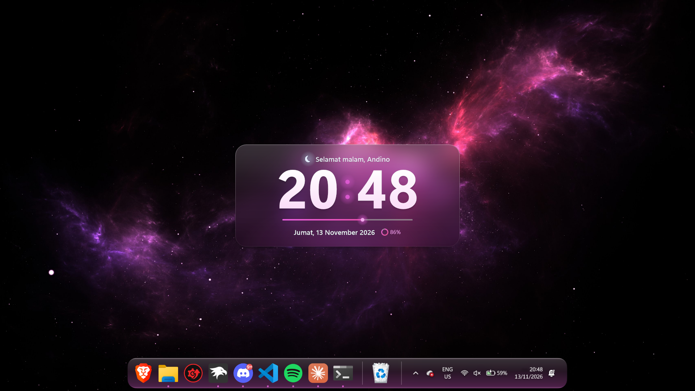

# Windows OCT

Setup Windows 11 saya: dock ala macOS berbalut kaca, jam kaca (frosted glass) di tengah desktop, dan animasi genie saat jendela di-minimize, dengan wallpaper nebula. Ketiga mod dipasang lewat [Windhawk](https://windhawk.net/).



## Isi repo

| File | Isi |
| --- | --- |
| `windows-oct-dock.cpp` | Windows-OCT Dock v2.0.1. Dock ala macOS (berbasis MacOS Style Dock 1.1.2) dengan skin Windows-OCT: kaca gelap senada wallpaper, glow aksen, kilau, dan garis tepi. Jam, tanggal, baterai, dan tray ada di dalam dock. |
| `windows-oct-clock.cpp` | Windows Oct Clock v1.1.0. Jam kaca di desktop berisi sapaan, tanggal, bar detik, dan progress hari. Warna aksennya diambil dari wallpaper lalu dibagikan ke dock. |
| `windows-oct-genie.cpp` | Windows-OCT Genie v1.1.0. Animasi genie ala macOS untuk minimize, restore, dan buka aplikasi (berbasis MacOS Minimize Animation 3.2.1). Animasinya mendarat tepat di ikon aplikasi di dock dan berjalan satu frame per refresh layar. |
| `space-art-nebula-8k-jy.jpg` | Wallpaper nebula 8K. |
| `Screenshot.png` | Hasil akhir. |

## Syarat

Windows 11 x64. Mod dock dan jam hanya dibuat untuk x86-64, jadi tidak jalan di Windows ARM.

## Langkah 1: Download repo

```bash
git clone https://github.com/andinoferdi/Windows-OCT.git
```

Tanpa Git: di halaman GitHub klik **Code → Download ZIP**, lalu extract.

## Langkah 2: Atur Windows

Blur di dock dan jam butuh mode Dark dan Transparency effects. Dock juga butuh taskbar dalam posisi bawaan.

1. Buka **Settings → Personalization → Colors**.
2. Di **Choose your mode**, pilih **Dark**.
3. Nyalakan **Transparency effects**.
4. Di **Settings → Personalization → Taskbar → Taskbar behaviors**, biarkan taskbar rata tengah (**Center**).
5. Di **Settings → Time & language → Date & time**, nyalakan **Show time and date in the System tray**. Jam dan tanggal di dock diambil dari sini.

Kalau **Energy saver** aktif, Windows mematikan efek transparan. Dock tetap jalan, tapi tampil dengan warna solid tanpa blur.

## Langkah 3: Pasang wallpaper

Pasang wallpaper sebelum mod jam, karena warna aksen jam diambil dari wallpaper.

Klik kanan `space-art-nebula-8k-jy.jpg` → **Set as desktop background**. Bisa juga lewat **Settings → Personalization → Background** → **Picture** → **Browse photos**, dengan **Choose a fit** diatur ke **Fill**.

## Langkah 4: Install Windhawk

Download installer dari [windhawk.net](https://windhawk.net/) dan jalankan, atau install lewat terminal:

```bash
winget install --id RamenSoftware.Windhawk
```

Lalu buka Windhawk.

## Langkah 5: Pasang mod dock (Windows-OCT Dock)

Matikan dulu semua mod taskbar lain di Windhawk, terutama TAI (Taskbar as Island), MacOS Style Dock, Taskbar Dock Animation (Plus), Taskbar height and icon size, dan Windows 11 Taskbar Styler. Dua mod taskbar yang aktif bersamaan akan saling bentrok.

1. Copy seluruh isi `windows-oct-dock.cpp`: buka di Notepad atau VS Code, tekan `Ctrl+A`, lalu `Ctrl+C`. Bisa juga dari PowerShell di folder repo:

   ```powershell
   Get-Content -Raw "windows-oct-dock.cpp" | Set-Clipboard
   ```

2. Di Windhawk, buka **Explore** → **Create a new mod**.
3. Di editor, tekan `Ctrl+A` lalu `Ctrl+V` untuk mengganti template bawaan.
4. Klik **Compile Mod** di kiri atas dan tunggu sampai selesai.
5. Klik **Exit editing mode**. Taskbar berubah jadi dock.

Auto-hide aktif secara bawaan: dock tersembunyi dan baru muncul saat kursor menyentuh tepi bawah layar.

## Langkah 6: Pasang mod jam (Windows Oct Clock)

Ulangi langkah 1 sampai 5 di atas dengan `windows-oct-clock.cpp`:

```powershell
Get-Content -Raw "windows-oct-clock.cpp" | Set-Clipboard
```

Setelah **Exit editing mode**, jam kaca muncul di tengah desktop. Dalam beberapa detik, dock ikut memakai warna dari jam.

## Langkah 7: Pasang animasi genie (Windows-OCT Genie)

Kalau **MacOS Minimize Animation** dari katalog terpasang, matikan dulu (Windhawk → **Home** → **Disable**). Kedua mod memakai hook yang sama.

Ulangi langkah 1 sampai 5 dengan `windows-oct-genie.cpp`:

```powershell
Get-Content -Raw "windows-oct-genie.cpp" | Set-Clipboard
```

Genie mencari posisi ikon di Windows-OCT Dock. Kalau dock tidak aktif, genie tetap jalan dengan pencarian taskbar biasa.

Ketiga mod sekarang ada di tab **Home** Windhawk sebagai `local@windows-oct-dock`, `local@windows-oct-clock`, dan `local@windows-oct-genie`.

### Upgrade dari versi lama repo ini

Versi lama memakai `TASKBAR MOD.cpp` (TAI) dan `CLOCK.cpp`, yang terpasang sebagai `local@taskbar-dock-like` dan `local@desktop-flip-clock`. Hapus atau matikan keduanya di tab **Home** sebelum memasang mod baru, supaya tidak ada dua mod taskbar atau dua jam yang jalan bersamaan.

## Langkah 8: Atur mod (opsional)

Screenshot memakai pengaturan bawaan, jadi langkah ini boleh dilewati. Untuk mengubah pengaturan, klik **Details** pada mod di tab **Home**, lalu buka tab **Settings**. Tabel di bawah hanya memuat sebagian pengaturan.

### Windows Oct Clock

| Pengaturan | Bawaan | Keterangan |
| --- | --- | --- |
| Greeting name | *(kosong)* | Kosong = sapaan memakai nama akun Windows. Isi `-` untuk sapaan tanpa nama. |
| Center on screen | On | Off = posisi jam diatur lewat **Top offset**. |
| Clock scale (%) | 100 | Ukuran jam, 50 sampai 200. |
| Bahasa Indonesia | On | Off = sapaan dan tanggal dalam bahasa Inggris. |
| Accent color | Auto dari wallpaper | Bisa diganti ke warna aksen Windows atau warna custom. |
| Glass tint | 38 | Makin tinggi, panel makin gelap. |
| Blur strength | 60 | Kekuatan blur panel. |

### Windows-OCT Dock: bentuk dan isi

Pengaturan dock dikelompokkan per grup. Kolom pertama menulis grup lalu nama pengaturannya.

| Pengaturan | Bawaan | Keterangan |
| --- | --- | --- |
| Dock → Size | 25 | Ukuran ikon dan dock, 0 sampai 100. |
| Dock → Opacity | 38 | Kepekatan latar dock. |
| Dock → Blur | 50 | Kekuatan blur di belakang dock. |
| Dock → Auto-hide | On | On = tersembunyi sampai kursor menyentuh tepi bawah. Hybrid = sembunyi hanya saat ada jendela maximize atau snap. Off = jendela berhenti di atas dock. |
| Magnification → Amount | 70 | Seberapa besar ikon membesar saat didekati kursor. |
| Magnification → Range | 55 | Jarak dari kursor yang ikonnya masih ikut membesar. |
| Dock items → Recycle Bin | On | Recycle Bin di ujung kanan dock. Klik untuk membuka, klik kanan untuk mengosongkan, seret file ke sana untuk menghapus. |
| Dock items → Show tooltips | On | Nama aplikasi muncul di atas ikon saat hover. |
| Dock items → Running indicators | Dots | Titik di bawah aplikasi yang terbuka. Pilihan lain: *Hybrid dots* dan *Windows 11*. |
| Hot corners → Bottom right | In the dock | Jam, tanggal, baterai, dan jaringan tampil di dalam dock setelah ikon aplikasi. |

### Windows-OCT Dock: skin Windows-OCT

Dock membaca warna dari mod jam lewat registry `HKCU\Software\Windows-OCT`. Di pengaturan dock, sumber warna ini bernama *Desktop Glass Clock*, yaitu nama lama dari Windows Oct Clock. Kalau mod jam tidak dipasang, dock memakai warna aksen Windows.

| Pengaturan | Bawaan | Keterangan |
| --- | --- | --- |
| Windows-OCT skin | On | Saklar utama semua efek di tabel ini. Off = dock polos sesuai pengaturan **Color**. |
| Accent source | Desktop Glass Clock | Sumber warna aksen. Pilihan lain: *Windows accent color* dan *Custom color*. |
| Custom accent color | `F05CD0` | Dipakai kalau Accent source = Custom. |
| Accent glow (0-100) | 30 | Glow aksen yang naik dari bawah dock. 0 = mati. |
| Glass sheen | On | Kilau putih tipis di setengah atas dock. |
| Edge light | On | Garis tepi putih di atas yang memudar ke warna aksen di bawah. |
| Accent running dots | On | Titik aplikasi yang terbuka berwarna aksen. |
| Tinted app name labels | On | Label nama aplikasi memakai warna senada wallpaper. |

### Windows-OCT Genie

| Pengaturan | Bawaan | Keterangan |
| --- | --- | --- |
| Minimize duration (ms) | 450 | Durasi animasi minimize, 100 sampai 1500. |
| Restore duration (ms) | 450 | Durasi animasi restore, 100 sampai 1500. |
| Animate app launch | On | Genie terbalik saat jendela aplikasi pertama kali muncul atau keluar lagi dari tray. |
| Animation style | Classic | *Classic* lebih ringan. *Modern* memakai mesh Direct2D dengan bentuk melengkung, tapi kerjanya lebih berat per frame. |
| Land on the Windows-OCT Dock icon | On | Off = memakai pencarian taskbar asli. |
| Frame pacing | Vblank | Satu frame per refresh layar. *Legacy* = timer asli. |
| Excluded programs | *(kosong)* | Program yang jendelanya tidak dianimasikan, misalnya `WindowsTerminal.exe`. |

## Troubleshooting

| Masalah | Solusi |
| --- | --- |
| Compile gagal | Pastikan seluruh isi file ter-copy, dari baris `// ==WindhawkMod==` paling atas sampai baris terakhir. Ulangi `Ctrl+A` → `Ctrl+V` di editor. |
| Taskbar tidak berubah atau tampil aneh | Matikan mod taskbar lain di Windhawk. Kalau belum berubah, restart Explorer: buka Task Manager → **Windows Explorer** → **Restart**. |
| Taskbar kadang balik ke bawaan setelah restart | Cek tab **Home** Windhawk: hanya boleh satu mod taskbar yang Enabled. |
| Ikon beranimasi dobel atau melompat | Dock sudah punya animasi pembesaran ikon. Matikan **Taskbar Dock Animation** atau mod dock lain. |
| Dock tidak blur, warnanya solid | Nyalakan **Transparency effects** dan matikan **Energy saver**. |
| Dock tidak kelihatan | Auto-hide aktif secara bawaan. Arahkan kursor ke tepi bawah layar, atau ubah **Dock → Auto-hide** ke *Off*. |
| Jam/tanggal tidak muncul di dock | **Settings → Time & language → Date & time** → nyalakan **Show time and date in the System tray**. |
| Menu baterai, WiFi, atau kalender muncul di pojok kanan, bukan di atas dock | Normal. Menu bawaan Windows tetap terbuka di tepi kanan layar. |
| Jam tidak kelihatan | Jam disembunyikan otomatis saat ada game atau aplikasi fullscreen, jadi tutup dulu aplikasinya. Pastikan juga mod jam **Enabled** di tab Home. |
| Warna jam tidak cocok setelah ganti wallpaper | Kalau warnanya tidak ikut berubah, matikan lalu nyalakan lagi mod jam. |
| Warna dock beda dari jam | Pastikan mod jam **Enabled**, lalu cek **Accent source** di pengaturan dock = *Desktop Glass Clock*. |
| Genie tidak jalan di sebagian aplikasi | Aplikasi yang tidak DPI aware memakai animasi bawaan Windows. Cek juga daftar **Excluded programs**. |
| Animasi minimize dobel | Matikan **MacOS Minimize Animation** dari katalog. Mod itu memakai hook yang sama dengan Genie. |
| Dock bermasalah setelah update besar Windows | Biasanya pulih setelah Microsoft merilis symbol file taskbar yang baru, bisa makan beberapa hari. Windhawk tidak bisa menambal celah ini untuk mod lokal seperti dock ini. |
| Mod error setelah update Windows | Klik **Details** → **Edit**, lalu **Compile Mod** ulang. |

## Kembali ke tampilan bawaan

Matikan atau hapus ketiga mod di tab **Home** Windhawk. Taskbar dan desktop langsung kembali normal. Untuk membersihkan semuanya, uninstall Windhawk dari **Settings → Apps → Installed apps**.

## Kredit

- Windows-OCT Dock berbasis MacOS Style Dock oleh [Zach Vaughn](https://github.com/zachvdev) (lisensi GPL-3.0), yang juga mengkredit m417z, notdominicc, dan Asteski. Tampilan skin-nya diambil dari efek aksen TAI (Taskbar as Island) oleh [DarkionAvey](https://github.com/DarkionAvey/windhawk-taskbar-centered-condensed).
- Windows-OCT Genie berbasis [MacOS Minimize Animation](https://windhawk.net/mods/macos-minimize-animation) oleh [Abdullah Masood](https://github.com/Abdullah-Masood-05) (lisensi MIT), dengan engine genie Direct2D oleh Potassiumuncher.
- Windows Oct Clock, skin Windows-OCT, dan perubahan di Genie dibuat oleh Andino Ferdiansah.
- [Windhawk](https://windhawk.net/) dibuat oleh Michael Maltsev ([m417z](https://github.com/m417z)).
