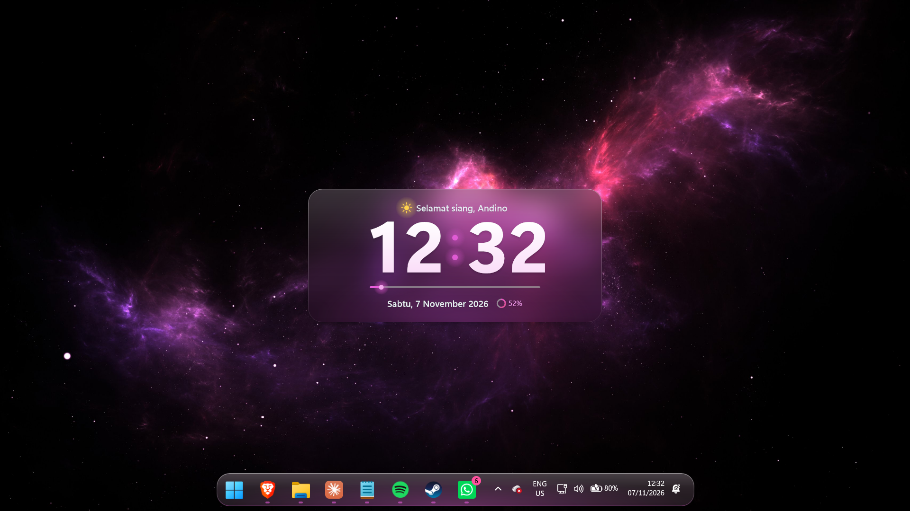

# Windows OCT

Setup tampilan Windows 11 saya: taskbar melayang seperti dock dan jam kaca (frosted glass) di tengah desktop, dengan wallpaper nebula. Semuanya dipasang pakai [Windhawk](https://windhawk.net/).



## Isi repo

| File | Fungsi |
| --- | --- |
| `TASKBAR MOD.cpp` | Mod Windhawk **TAI (Taskbar as Island)** v1.5.259, versi yang sudah di-patch supaya jalan di Windows 11 26H2. Bikin taskbar melayang di tengah, sudutnya membulat, dan tray-nya menempel di samping ikon aplikasi. Ditambah efek **kembaran jam**: kaca bertint, glow aksen dari bawah, kilau kaca, edge light, indikator aplikasi dan hover berwarna aksen. |
| `CLOCK.cpp` | Mod Windhawk **Desktop Glass Clock** v1.1.0. Jam kaca di desktop dengan sapaan, tanggal, bar detik, dan progress hari. Warna aksennya otomatis mengikuti wallpaper, lalu dibagikan ke taskbar supaya warnanya sama persis. |
| `space-art-nebula-8k-jy.jpg` | Wallpaper nebula 8K. |
| `Screenshot.png` | Contoh hasil akhirnya. |

## Yang dibutuhkan

- Windows 11 64-bit (x64). Kedua mod ini hanya untuk x86-64, jadi tidak bisa dipakai di Windows ARM.
- Koneksi internet untuk download Windhawk.
- Kalau mau clone repo ini, perlu Git. Kalau tidak, cukup download ZIP-nya dari GitHub.

---

## Langkah 1: Download repo ini

Pakai Git:

```bash
git clone https://github.com/andinoferdi/Windows-OCT.git
```

Atau di halaman GitHub klik **Code → Download ZIP**, lalu extract.

## Langkah 2: Atur pengaturan Windows

Efek blur di taskbar dan di jam butuh dua pengaturan ini.

1. Buka **Settings → Personalization → Colors**.
2. **Choose your mode** → pilih **Dark**.
3. Nyalakan **Transparency effects**.

> Kalau **Energy saver** aktif, Windows mematikan efek transparan. Taskbar tetap jalan, tapi tampilannya jadi warna solid tanpa blur.

## Langkah 3: Pasang wallpaper

1. Klik kanan `space-art-nebula-8k-jy.jpg` → **Set as desktop background**.
2. Atau lewat **Settings → Personalization → Background** → **Picture** → **Browse photos**, lalu pilih file wallpaper-nya. Atur **Choose a fit** ke **Fill**.

Wallpaper dipasang **sebelum** mod jam, karena warna aksen jam diambil dari wallpaper.

## Langkah 4: Install Windhawk

1. Download installer-nya dari [windhawk.net](https://windhawk.net/), lalu jalankan dan ikuti langkahnya sampai selesai.
   Bisa juga lewat terminal:

   ```bash
   winget install --id RamenSoftware.Windhawk
   ```

2. Buka **Windhawk**.

## Langkah 5: Pasang mod taskbar (TAI)

> ⚠️ Sebelum mulai, **matikan mod Windhawk lain yang mengubah tinggi taskbar atau ikon taskbar**. Fitur-fitur itu sudah ada di mod ini, dan kalau dipakai bersamaan bisa bentrok.

1. Buka `TASKBAR MOD.cpp` pakai Notepad atau VS Code, tekan `Ctrl+A`, lalu `Ctrl+C`.
   Atau dari PowerShell di folder repo ini:

   ```powershell
   Get-Content -Raw "TASKBAR MOD.cpp" | Set-Clipboard
   ```

2. Di Windhawk, buka **Explore** → klik **Create a new mod**.
3. Di editor yang terbuka, tekan `Ctrl+A` lalu `Ctrl+V` supaya template bawaan terganti dengan isi file tadi.
4. Klik **Compile Mod** di kiri atas, lalu tunggu sampai selesai.
5. Klik **Exit editing mode**. Taskbar akan berubah jadi dock yang melayang.

## Langkah 6: Pasang mod jam (Desktop Glass Clock)

1. Copy seluruh isi `CLOCK.cpp`:

   ```powershell
   Get-Content -Raw "CLOCK.cpp" | Set-Clipboard
   ```

2. Di Windhawk: **Explore** → **Create a new mod** → `Ctrl+A` → `Ctrl+V`.
3. Klik **Compile Mod**, lalu **Exit editing mode**.
4. Jam kaca akan muncul di tengah desktop.

Kedua mod sekarang ada di tab **Home** Windhawk, dengan nama `local@taskbar-dock-like` dan `local@desktop-flip-clock`.

## Langkah 7: Atur mod (opsional)

Di tab **Home**, klik **Details** pada mod yang mau diatur, lalu buka tab **Settings**. Hasil di screenshot memakai **pengaturan bawaan** dari kedua mod, jadi tidak ada yang perlu diubah supaya hasilnya sama.

Beberapa pengaturan yang sering diubah:

**Desktop Glass Clock**

| Pengaturan | Bawaan | Keterangan |
| --- | --- | --- |
| Greeting name | *(kosong)* | Kalau kosong, sapaan memakai nama akun Windows. Isi `-` kalau sapaannya mau tanpa nama. |
| Center on screen | On | Kalau Off, posisi jam diatur pakai **Top offset**. |
| Clock scale (%) | 100 | Ukuran jam, 50–200. |
| Bahasa Indonesia | On | Off = sapaan dan tanggal dalam bahasa Inggris. |
| Accent color | Auto dari wallpaper | Bisa diganti ke warna aksen Windows atau warna custom. |
| Glass tint | 38 | Makin tinggi, panelnya makin gelap. |
| Blur strength | 60 | Seberapa kuat blur di panel. |

**TAI (taskbar)**

| Pengaturan | Bawaan | Keterangan |
| --- | --- | --- |
| Taskbar height | 56 | Tinggi taskbar. |
| Taskbar icon size | 30 | Ukuran ikon. Harus lebih kecil dari button size. |
| Taskbar vertical offset | 8 | Jarak taskbar dari bawah layar. |
| Taskbar corner radius | 22 | Makin besar, sudutnya makin bulat. |
| Background blur amount | 30 | Kekuatan blur di belakang taskbar. |
| Full-width taskbar background | Off | On = latar taskbar selebar layar seperti bawaan Windows. |
| Accent effects (twin of Desktop Glass Clock) | On | Saklar utama semua efek aksen di bawah. Off = tampilan TAI biasa. |
| Accent source | Desktop Glass Clock | Sumber warna aksen. Bisa juga *Windows accent color* atau *Custom color*. |
| Custom accent color | `#F05CD0` | Dipakai kalau Accent source = Custom. |
| Accent glass tint (%) | 38 | Tint gelap kaca yang senada wallpaper, sama seperti panel jam. 0 = pakai pengaturan tint biasa. |
| Accent glow (%) | 30 | Kekuatan glow aksen yang naik dari bawah dock. 0 = mati. |
| Glass sheen | On | Kilau putih tipis di setengah atas dock. |
| Edge light | On | Garis tepi putih terang di atas yang memudar ke warna aksen di bawah. |
| Accent running indicators | On | Garis di bawah ikon aplikasi jadi warna aksen. Aplikasi yang minta perhatian (berkedip) tetap pakai warna Windows. |
| Accent hover glow | On | Latar tombol berpendar aksen saat di-hover atau diklik. Tidak tampil selama Dock animation aktif. |
| Dock animation | On | Hover ala macOS: tombol di dekat kursor membesar dan tetangganya bergeser memberi ruang. Mati sendiri kalau *Animation effects* Windows dimatikan. |
| Dock animation size (%) | 130 | Ukuran tombol tepat di bawah kursor. |
| Dock animation reach (px) | 100 | Seberapa jauh dari kursor tombol masih ikut membesar. |
| Dock animation curve | Cosine | Bentuk penurunan ukuran: *Cosine* (halus), *Linear*, atau *Exponential* (puncak tajam). |
| Dock animation spacing (%) | 50 | Seberapa jauh tetangga bergeser. 0 = tidak bergeser. |
| Dock animation follow speed | 60 | Seberapa cepat tombol mengejar kursor. 0 = langsung. |
| Dock animation fade (ms) | 150 | Lama efek muncul saat kursor masuk dan hilang saat keluar. |
| Dock animation bounce | On | Tombol di bawah kursor yang diam memantul pelan. |
| Dock animation bounce delay (ms) | 500 | Lama kursor harus diam sebelum mulai memantul. |
| Dock animation bounce lift | On | Pantulan mengangkat tombol. Off = hanya membesar-mengecil. |
| Dock animation labels mode | Off | Nyalakan kalau label taskbar ditampilkan. |
| Dock animation system buttons | All buttons | Apakah Start, Search, Task View dan Widgets ikut beranimasi. |

> Taskbar mengambil warna aksen dari mod jam lewat registry `HKCU\Software\Windows-OCT`. Jadi setelah update repo ini, **compile ulang kedua mod**. Kalau mod jam tidak dipasang, taskbar memakai warna aksen Windows.

---

## Troubleshooting

| Masalah | Solusi |
| --- | --- |
| Compile gagal | Pastikan semua isi file ter-copy, mulai dari baris `// ==WindhawkMod==` paling atas sampai baris terakhir. Ulangi langkah `Ctrl+A` → `Ctrl+V` di editor. |
| Taskbar tidak berubah atau kelihatan aneh | Matikan mod taskbar lain di Windhawk. Kalau masih belum berubah, restart Explorer: buka Task Manager → cari **Windows Explorer** → **Restart**. |
| Taskbar tidak blur, warnanya solid | Nyalakan **Transparency effects** dan matikan **Energy saver**. |
| Jam tidak kelihatan | Jam otomatis disembunyikan saat ada game atau aplikasi fullscreen, jadi tutup dulu aplikasinya. Pastikan juga mod-nya **Enabled** di tab Home. |
| Warna jam tidak cocok setelah ganti wallpaper | Biasanya warnanya menyesuaikan sendiri. Kalau tidak, matikan lalu nyalakan lagi mod jamnya. |
| Warna taskbar beda dari jam | Pastikan mod jam **Enabled** dan sudah di-compile ulang (v1.1.0), lalu cek setting TAI **Accent source** = *Desktop Glass Clock*. |
| Ikon taskbar beranimasi dobel atau melompat | Animasi dock sudah ada di TAI. Matikan mod **Taskbar Dock Animation** (atau mod dock lain) di Windhawk. |
| Efek aksen bikin taskbar terasa aneh | Matikan **Accent effects** di Settings mod TAI untuk kembali ke tampilan TAI biasa, atau matikan efeknya satu per satu. |
| Setelah update Windows, mod error | Klik **Details** → **Edit**, lalu **Compile Mod** ulang. Kalau tetap error, cek versi terbaru mod TAI di repo aslinya (lihat Kredit). |

## Mengembalikan ke tampilan bawaan

Di tab **Home** Windhawk, matikan atau hapus kedua mod tersebut. Taskbar dan desktop langsung kembali normal. Kalau mau benar-benar bersih, uninstall Windhawk dari **Settings → Apps → Installed apps**.

## Kredit

- **TAI (Taskbar as Island)** dibuat oleh [DarkionAvey](https://github.com/DarkionAvey/windhawk-taskbar-centered-condensed) dan dirilis di bawah lisensi **GNU GPL v3.0**. Versi di repo ini sudah ditambah patch kompatibilitas untuk Windows 11 26H2.
- **Desktop Glass Clock** dibuat oleh Levelup iD.
- [Windhawk](https://windhawk.net/) dibuat oleh Michael Maltsev ([m417z](https://github.com/m417z)).
